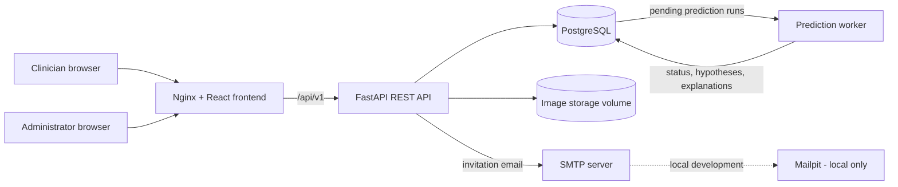
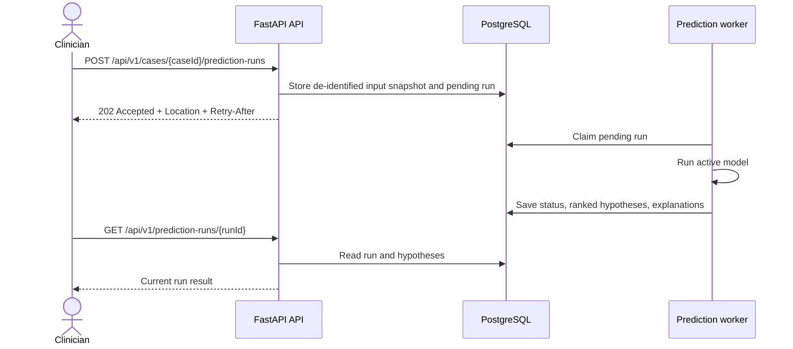

# System architecture

EVIDEA is a single-deployment web application. The browser serves the React frontend and sends API
requests through the same-origin nginx proxy. The FastAPI API and prediction worker use PostgreSQL;
the worker claims queued prediction runs, performs inference, and writes results back to the
database. Uploaded images use the shared storage volume. SMTP delivery is external in production
and routed to Mailpit during local development.

## Components

## Prediction request lifecycle

The prediction snapshot excludes patient names, email addresses, and phone numbers. Prediction
results are decision support only; they do not replace clinician judgment.

## Data architecture

The operational database contains application/authentication data, patient and case records, model
metadata, prediction results, and reference catalogs. The ML model is trained offline; production
stores model metadata and uses the configured artifact location rather than storing training data
in the operational database.

See the [data dictionary](../backend/docs/docs_db/data-dictionary.md) for database layers and table
details, the [ER diagram](../backend/docs/diagrams/EHR_Polina_Trybialustava.jpg) for relationships,
and [database versioning](../backend/docs/docs_db/versioning.md) for migration rules.
